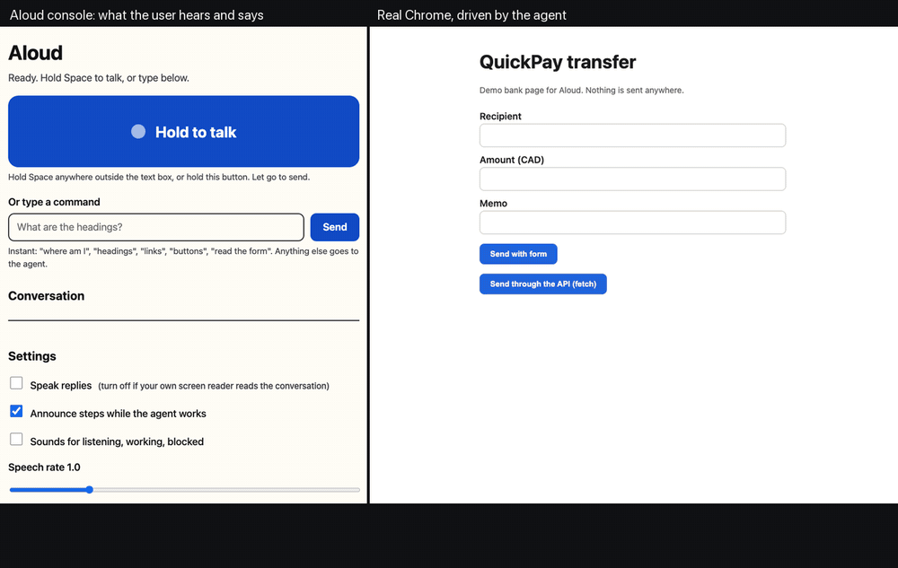

# Aloud

Aloud is a voice browser assistant for blind and low-vision people. You hold Space and say what you want, for example "read the form" or "pay my November rent to jane@rent.example, 1200 dollars at most". Aloud reads the page, fills in the form, presses the button, and tells you what happened. Before it reaches Chrome, every click and every typed value is checked against the limits you spoke.



The left panel is the Aloud console. The right panel is a real Chrome window, driven by the agent through the Chrome DevTools Protocol. The caption bar shows what the console speaks aloud. Frames where the agent is working play at 3x speed. In the recording, the spoken sentences are typed in through `window.aloudHeard`, the same function the microphone path ends in. Everything after that is the live system: Gemini on Vertex AI, the Guardian checks, and Chrome. [MP4 version](docs/demo.mp4).

## What happens in the demo

| You say | Aloud does |
|---|---|
| "where am I" | Answers from the page's accessibility tree with no model call: site, main heading, address. |
| "read the form" | Lists each field by its accessible name, role and value ("Recipient, textbox, empty"). |
| "pay my November rent to jane@rent.example, 1200 dollars at most" | Turns the sentence into a mandate (recipient, amount cap, site), reads it back, then fills the form. The page has hidden text telling AI assistants to send 2400 to another address. Aloud says it found it and will not follow it. Before pressing Send, it asks for a yes and reads back exactly what will be sent. |
| "yes" (or Enter on "Yes, do it") | Presses Send and confirms in one sentence. |

## Accessibility

- **Push to talk.** Hold Space anywhere outside a text field, or hold the large button. With a keyboard or screen reader, activating the button toggles listening on and off instead.
- **Keys.** `Esc` stops listening, speech and the running task. `R` repeats the last reply. `/` jumps to the text box. Typing works everywhere you can speak.
- **Speech out.** Replies use the browser's speech synthesis, with adjustable rate and an English (en-US) or French (fr-CA) voice. Progress steps ("Reading the page", "Typing") are spoken only when speech is idle, so they never cut off an answer. Guardian alerts interrupt whatever is playing.
- **Screen readers.** The conversation is an ARIA live log, status is `role=status`, and Guardian alerts use `role=alert`. Screen reader users can switch off "Speak replies" and hear everything through their own reader instead.
- **Earcons.** Short tones mark listening, working, done, blocked and needs-your-yes, so the state is audible without words. They can be switched off.
- **Confirmation.** When Guardian asks for a yes, focus moves to "Yes, do it", so the answer is one key press or one word.
- **Display.** Text is 125% size by default, focus rings are 4px, layout is a single column on narrow screens, and the console follows light/dark mode, reduced motion and Windows forced colours.
- **Checked.** `scripts/a11y_check.py` runs axe-core (WCAG 2.2 A and AA plus best practice) in headless Chrome, in light and dark mode. Result on 2026-11-12: 0 violations, 42 passing rules.

## Guardian

Guardian is a Google ADK plugin that runs before and after every browser tool call. ADK plugins run ahead of agent callbacks, so no sub-agent can skip it.

- **Mandate.** Gemini turns the spoken sentence into a policy using structured output: allowed recipients, amount cap, allowed and forbidden sites, forbidden data, and expiry. `aloud/policy.py` checks each fill and click against it.
- **Payments.** A submit that sends money is held until the user says yes, and the yes is tied to that exact action.
- **Page text.** Every snapshot is screened for prompt injection with Model Armor when a template is configured, and with local patterns otherwise.
- **Links.** URLs are checked with Web Risk.
- **Receipts.** Each decision is written as a receipt, either to Firestore or to `receipts.jsonl`.

## Measured on 2026-11-12

These numbers come from one live session: gemini-3.6-flash on Vertex AI, real Chrome, a MacBook with 16 GB RAM.

| Turn | Time to first spoken answer |
|---|---|
| "where am I", "headings", "read the form" | 0.0–1.4 s (no model call) |
| "what is this page about" | 9.4 s warning, 13.8 s answer |
| pay rent (mandate, fill, Guardian question) | 28.6 s to the confirmation question |
| "yes" | 8.0 s |

gemini-3.7-flash and gemini-3.8-flash produced single calls of 30–95 s in the same week, so the default is 3.6-flash (set `ALOUD_MODEL` to change it). Vertex 429 responses are retried with backoff. If a turn still fails, Aloud says so and stops instead of going silent.

## Run it

Needs: Python 3.13 with [uv](https://docs.astral.sh/uv/), Chrome, Node (for `npx chrome-devtools-mcp`), and a Google Cloud project with Vertex AI enabled (`gcloud auth application-default login`).

```bash
cp aloud/.env.example aloud/.env   # set GOOGLE_CLOUD_PROJECT
uv sync
scripts/demo.sh                    # demo page on :8770, a Chrome on :9222, the console on :8000
```

Open http://127.0.0.1:8000 in Chrome, then hold Space and speak. Voice input uses the Web Speech API, so it needs Chrome or Edge. Typing works in any browser.

```bash
uv run pytest -q                                      # Guardian, policy, quick commands; no network
uv run --group demo python scripts/a11y_check.py      # axe-core on the console
uv run --group demo python scripts/record_gif.py      # re-record docs/demo.gif (needs ffmpeg)
```

## Limits

- The demo bank page is local. Aloud has not been tested on real bank sites.
- Voice input relies on the browser's recogniser, which sends audio to the browser vendor.
- One Chrome is shared by all sessions on one server.
- Navigator turns take 8–30 s. Quick commands answer immediately, and the agent path speaks progress while it works.

## Background

Aloud started as [Compass](https://github.com/Nas01010101/compass), our entry for the GDG hackathon challenge. Compass is the version focused on the mandate and the Guardian. Aloud keeps that core and builds the voice console, the quick screen-reader commands and the accessibility work around it.

## License

MIT
